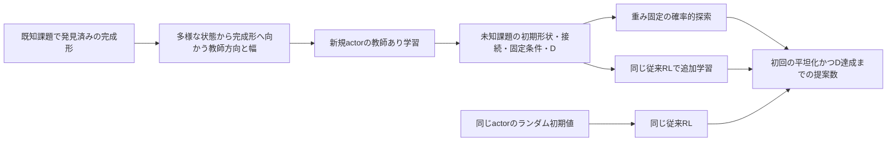

# 実装した「経験の利用」

既知課題の完成形から作る教師学習と、未知課題での初回発見を分離した。未知課題の完成座標は使わない。

## 教師が持つ情報と、NNが持つ情報

教師側は既知の完成座標を知っている。制約を満たす現在状態から、その座標へ向かう物理空間の方向と受理されたstep幅をラベルにする。
基準形状・ランダムな可動状態に加え、既知課題でNNが訪れた状態にも教師を付け、途中状態の不足を補った。
これは既知課題内でのデータ追加であり、未知構造へ教師を問い合わせる処理ではない。

NNには完成座標を渡さない。現在節点位置、目標D、接続・固定条件などの問題定義、平坦化の次元を渡す。モードは現在状態から計算する。
linkageでは1次元の直線への平坦化、waterbomb/torusでは2次元の面への平坦化を指定する。
Dは条件入力であり、この実装では観測されない潜在変数ではない。数値入力だが、D2.5の教師を補間生成していない。

初回発見に使ったRL actorの重みは教師学習の初期値にしない。既知RL結果から利用するのは、完成座標と、許可した既知課題の経路状態である。
未知課題のcriticとoptimizerも新規に作る。

## actorの表現

`dense`は従来の固定節点数NNにD入力を加えたもの。`legacy`はD入力も加えない従来NNの参照条件。
`graph`は各節点の特徴を共有し、隣接節点との情報交換を2回行う。節点数が変わってもactorの重みを共有できる。
ただしモードごとの非線形処理には、SVD基底の符号・回転による影響があり得る。

`projected`はNNが節点ごとの移動場 \(v\) を出し、その後で現在のモードへ投影する。
コードでモードを行に持つ行列を \(M\) とすると、係数平均は

\[
\mu_a=\frac{Mv}{\sqrt{1+\|Mv\|^2}}
\]

とする。物理空間の平均方向は \(M^\mathsf{T}\mu_a\) の正規化で得る。
モード基底を直交変換しても物理平均が変わらず、モード分散を共通にすることで物理共分散も変わらない。テストで確認した。
projectedではモードを節点encoderの特徴に入れず、出力側の投影に使う。従来agentへは、ほかのactorと同じモード係数分布・幅分布を返す。

幅は状態・物理方向・集約した節点特徴から別headで出力する。従来agentの半球正規化に合わせ、符号付きtanh幅として扱う。
教師方向の損失、符号を合わせた幅の損失、係数平均のノルムを調整する小さな損失を合わせる。
教師学習はcriticと分散headを更新しない。

## 学習データと選択

混合経験モデルprojected_waterの教師データは次のとおり。

| 既知構造 | 既知D | ラベル数 | 学習 / 検証 |
|---|---|---:|---:|
| five bar | 2, 3 | 5,026 | 4,200 / 826 |
| seven bar | 2, 3 | 6,952 | 5,542 / 1,410 |
| waterbomb | 1, √2 | 936 | 756 / 180 |

隣接した経路点をランダムに分割せず、初期状態・経路のグループを単位として検証側へ分ける。
batch size 32、Adamの学習率0.001、20,000更新で、既知課題の検証損失が最小のcheckpointを選ぶ。
未知課題での成功回数によるcheckpoint選択はしない。
projected_barsは同じbarデータを残し、waterの936ラベルを使わない追試である。

seven→five専用のgraph_sevenは、sevenだけのデータと、sevenだけで学習したcollectorを使う。
混合経験モデルをfive未知の証拠として使うことはしない。

## 未知課題での比較

| 条件 | actor初期値 | 未知課題での重み更新 |
|---|---|---|
| scratch | 新規ランダム | 従来RL |
| finetune | 既知課題の教師学習済み | 従来RL |
| frozen | 同じ教師学習済み | なし。確率的行動で繰り返し探索 |
| deterministic | 同じ教師学習済み | なし。平均行動で1経路 |

環境、報酬、Gaussian行動の処理、8エピソードごとのMC actor–critic更新は既存コードを利用する。
最初の成功時点で停止するため、最初のRL更新前に成功したfinetuneとfrozenは同じ経路になる。二つの独立した成功とは数えない。
目標入力を置き換える補足条件でも、環境の報酬・成功判定は本来の目標Dのままにする。

成功は既存の `strict_success`、すなわちflatness ratio ≤ 0.001かつD誤差 ≤ 0.05。
特定の重なり順や完成座標との一致は要求しない。提案数には棄却された行動、失敗した先行エピソードも含む。
時間切れや予算内未発見を、成功例だけの平均から除外して速度を主張しない。
教師生成・事前学習の費用は未知課題のオンライン提案数に含めず、別に記録する。

## 今回の限界

同じ状態・Dでも望ましい経路が分岐する可能性は、この単一平均の教師学習では解決していない。
また、D3をNNへ入力したまま未知D4が見つかるため、成功を「未知Dへ正確に追従するNNができた」とは解釈しない。
現段階の評価対象は、過去の経験で学んだ探索方策が初回発見を助けるかどうかである。

今回の設計追加には未知課題の観察を使っているため、探索的な結果である。
最終的な汎化性能の確認には、モデル・教師集合・選択規則を固定し、新しく確保した構造群で初回発見を比較する必要がある。
